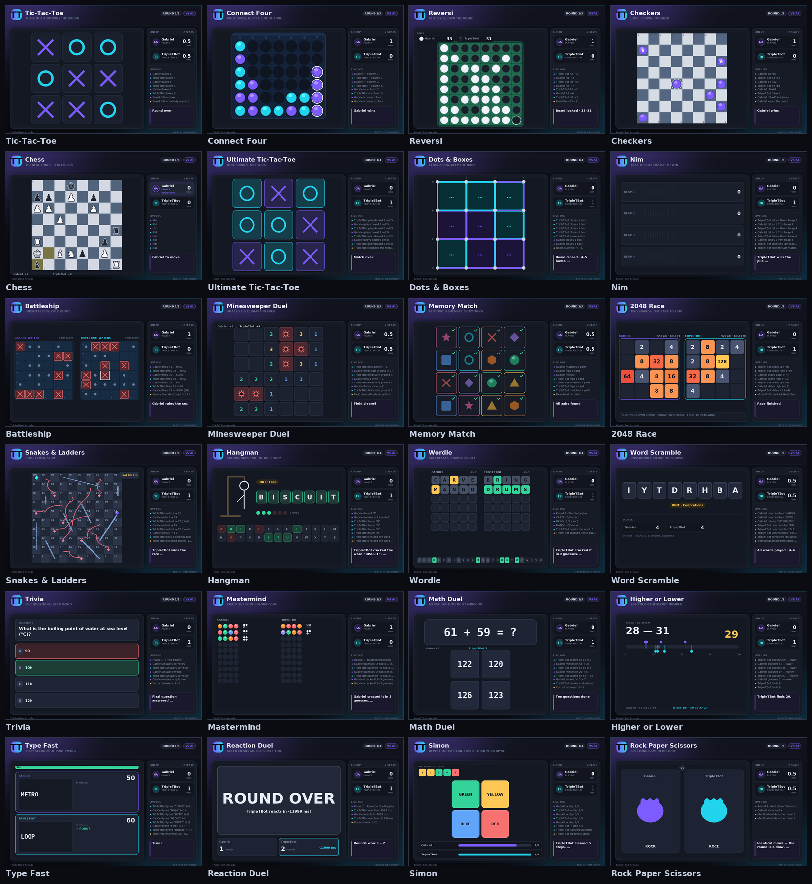

# TripleTBot 🎮

**A Discord bot that turns 24 games into live, rendered boards — no walls of text, no ASCII.**

Every move redraws a real image (1100×720, Pillow) and edits the same message, so the whole
channel watches the match in real time: the board, the pieces, the score, the live log and
whose turn it is. Players interact through Discord buttons, dropdowns and typed modals.



---

## Table of contents

- [The 24 games](#the-24-games)
- [Commands](#commands)
- [Quick start (5 minutes)](#quick-start-5-minutes)
- [Deploy so it runs 24/7](#deploy-so-it-runs-247--no-github-needed)
- [Try it without Discord](#try-it-without-discord)
- [Playing against other bots](#playing-against-other-bots)
- [How it works](#how-it-works)
- [Project layout](#project-layout)
- [Self-check](#self-check)

---

## The 24 games

| # | Game | Command | Players | Engine |
|---|------|---------|---------|--------|
| 1 | Tic-Tac-Toe | `/xox` | 1v1 | perfect play (minimax) |
| 2 | Connect Four | `/connect4` | 1v1 | alpha-beta, 6-ply |
| 3 | Reversi | `/reversi` | 1v1 | positional + mobility eval |
| 4 | Checkers | `/checkers` | 1v1 | 6-ply, forced captures, kings |
| 5 | Chess | `/chess` | 1v1 | **full legal chess** (castling, en passant, promotion, mate, stalemate) |
| 6 | Ultimate Tic-Tac-Toe | `/ultimate_xox` | 1v1 | board-capture heuristics |
| 7 | Dots & Boxes | `/dots_boxes` | 1v1 | box denial heuristics |
| 8 | Nim | `/nim` | 1v1 | perfect nim-strategy |
| 9 | Battleship | `/battleship` | 1v1 | hunt/target with parity search |
| 10 | Minesweeper Duel | `/minesweeper` | 1v1 | risk-averse digging |
| 11 | Memory Match | `/memory` | 1v1 | remembers what it saw |
| 12 | 2048 Race | `/game2048` | 1v1 | greedy merge/value search |
| 13 | Snakes & Ladders | `/snakes` | 1v1 | dice (no decisions, pure drama) |
| 14 | Hangman | `/hangman` | 1v1 | letter-frequency dictionary attack |
| 15 | Wordle | `/wordle` | 1v1 | constraint filtering |
| 16 | Word Scramble | `/scramble` | 1v1 | dictionary solver |
| 17 | Trivia | `/trivia` | 2–4 | 70-question bank |
| 18 | Mastermind | `/mastermind` | 1v1 | Knuth-style minimax partitioning |
| 19 | Math Duel | `/mathduel` | 2–4 | accuracy-scaled solver |
| 20 | Higher or Lower | `/guessnumber` | 1v1 | binary search |
| 21 | Type Fast | `/typefast` | 1v1 | 60-second typing race |
| 22 | Reaction Duel | `/reaction` | 2–4 | 3 rounds, millisecond timing |
| 23 | Simon | `/simon` | 1v1 | pattern speed duel |
| 24 | Rock Paper Scissors | `/rps` | 2–4 | secrecy + reveal |

Plus `/play game:<any>` which does the same thing from a single command.

Gameplay details worth knowing:

- **Rounds are real.** `/chess vs:@Ana rounds:5` is a five-round match with a scoreboard; the
  next round starts automatically five seconds after each result (or right away with the button).
- **Seats are enforced.** Only the two players can press buttons; anyone else is a spectator and
  gets an ephemeral nudge if they try.
- **Timed games are actually timed.** Type Fast counts down 60 s, Reaction Duel schedules the
  green light server-side and measures reaction time in milliseconds, Simon races both players
  on the same pattern.
- **Everything is one message.** Each move edits the existing message with a new attachment, so a
  channel never floods with 300 board images.

---

## Commands

```
/play    game:<name> vs:@rival rounds:<1-9> difficulty:<Easy|Normal|Hard|Insane>
/xox /chess /connect4 /typefast …            (one command per game, same options)

/games         poster of all 24 games
/rules         how a specific game works
/stats         your record (or someone else's)
/leaderboard   top players in the server
/cancel        close the match running in this channel
/tripletbot    quick help card
```

`vs` accepts a normal member **or another bot** in the server. Leave it empty and you play
TripleTBot's engine. `difficulty` only matters when a bot is on the board.

---

## Quick start (5 minutes)

You only need a phone/browser for this — no local install required.

### 1. Create the bot application

1. Open <https://discord.com/developers/applications> → **New Application**, name it `TripleTBot`.
2. **Bot** tab → **Reset Token** → copy the token (keep it secret).
3. On the same page make sure **Public Bot** is on (so anyone can invite it) and
   **Message Content Intent** stays *off* (TripleTBot only uses slash commands).

### 2. Invite it to a server

**OAuth2 → URL Generator**, tick:

- Scopes: `bot`, `applications.commands`
- Bot permissions: *Send Messages*, *Embed Links*, *Attach Files*, *Read Message History*,
  *Use External Emojis* (or just **Administrator** while testing)

Open the generated URL, pick your server, authorize.

### 3. Run the code

```bash
git clone https://github.com/gabrielainod/Discord-bot-with-agent-mode
# (or just download dist/triplettbot.zip and unzip it — same thing)
cd Discord-bot-with-agent-mode
pip install -r requirements.txt
cp .env.example .env          # paste your token into DISCORD_TOKEN
python -m tripletbot
```

When the console prints `[TripleTBot] online as TripleTBot#1234 · 24 games ready`, go to any
channel and type `/play`. Global slash commands can take up to an hour to appear the first time;
set `GUILD_ID=<your server id>` in `.env` to sync instantly while testing.

---

## Deploy so it runs 24/7 — no GitHub needed

Everything you need is packed in **`dist/triplettbot.zip`** (1 MB, 43 files, includes the
fonts). Upload it, unzip it, set `DISCORD_TOKEN`, run `python main.py`. That is the whole
contract — no git, no repository, no CI.

Three phone-friendly routes, with exact steps in **[HOSTING.md](HOSTING.md)**:

| Route | Cost | How it works |
|---|---|---|
| **Panel with ZIP upload** (Pterodactyl-style) | free tiers exist | create server → File Manager → upload `triplettbot.zip` → *Unarchive* → add `DISCORD_TOKEN` → Start |
| **VPS / shell you can reach** | ~US$3–5/mo | `unzip` → `bash start.sh` (or the bundled `Dockerfile`) |
| **Old Android phone (Termux)** | free, forever | `pkg install python python-pillow` → unzip → `python main.py`, keep it charging |

All of them use the same start command, so switching hosts later is copy-paste.

## Try it without Discord

The repo ships a playable browser simulator that uses **the same engine and the same frames**:

```bash
python tools/sim_server.py       # http://localhost:8000
```

It renders a phone-sized Discord-style conversation: pick any of the 24 games, tap the buttons,
type your Wordle guesses, watch `AI vs AI` matches. Handy for testing on a phone or demoing
without a token.

You can also export every game to PNG (and a real animated replay GIF):

```bash
python -m tools.showcase          # showcase/*.png + contact-sheet.png + replay.gif
```

---

## Playing against other bots

You can `/play game:connect4 vs:@SomeGameBot` — but be aware of a Discord platform limit:
**bots cannot click other bots' buttons or answer modals.** There is no client-side way for
`@SomeGameBot` to take its turn by itself.

So TripleTBot does the honest version of it:

1. The match starts with that bot's **name and avatar** on the board.
2. Its moves are played by TripleTBot's engine (an *AI proxy*), at the difficulty you chose.
3. The frame and the embed label it `BOT · AI PROXY` so nobody is misled.

If the other bot exposes its own HTTP API, wiring it in is a small adapter (implement the same
`ai_action()` the engine uses).

---

## How it works

```
Discord interaction ──▶ MatchView ──▶ Match.act(seat, action) ──▶ Game.act()
                            ▲                                        │
                       new components                                ▼
   Discord message ◀── Match.render() ◀── Frame ◀── Game.draw()  (Pillow)
```

- **`tripletbot/games/`** — 24 pure state machines. No Discord imports. Each one exposes
  `status()`, `acting()`, `act(seat, action)`, `legal_actions()`, `ai_action()`, `view()` and
  `draw(frame)`. They work identically in the bot, the simulator and the tests.
- **`tripletbot/core/match.py`** — rounds, scoring (win = 1, draw = 0.5 each), the live log, and
  `pulse()`: the once-a-second heartbeat that runs timers and lets bots move. This is why a bot
  can play in real time without blocking the event loop.
- **`tripletbot/render/`** — the visual language: palette, typography (bundled DejaVu), cards,
  avatars, board helpers, result overlays, the `/games` poster.
- **`tripletbot/discordbot/`** — slash commands, per-channel sessions, and `ui.py`, which turns a
  game's `ViewModel` (buttons / selects / modal) into real Discord components.
- **`tripletbot/core/ai.py`** — negamax + alpha-beta with time budgets, difficulty profiles
  (blunder rate + search depth) and personas.

Rendering budget: a frame takes ~60–120 ms including the PNG encode, so editing a message after
each move stays comfortably inside Discord's rate limits (one edit per move, never more).

---

## Project layout

```
tripletbot/
  core/        match.py · types.py · ai.py · stats.py
  games/       base.py · board.py · board2.py · strategy.py · grid.py · words.py · arcade.py
  render/      theme.py · frame.py · boards.py · catalog.py
  discordbot/  bot.py · ui.py
  data/        words.py  (Wordle / Hangman / Scramble / Trivia banks)
  web/         index.html (simulator UI)
tools/         showcase.py · selftest.py · sim_server.py
assets/fonts/  DejaVu (OFL-style license, see assets/fonts/README.md)
showcase/      rendered screenshots + replay.gif
```

---

## Self-check

```bash
python tools/selftest.py          # 24/24 games must finish a match, render and build a UI
```

It autoplays a full match of every game with the engine on both sides, renders the frame,
and validates the Discord component tree (count, custom ids, row limits).

```
game                    steps   render  discord  result
xox                         9     416ms       ok  Selftest A connected three in a row.
chess                     276   96769ms       ok  Checkmate — Selftest B delivers it.
…
24/24 games healthy
```

---

## License

MIT — see [LICENSE](LICENSE). The bundled DejaVu fonts keep their own license
([details](assets/fonts/README.md)).
